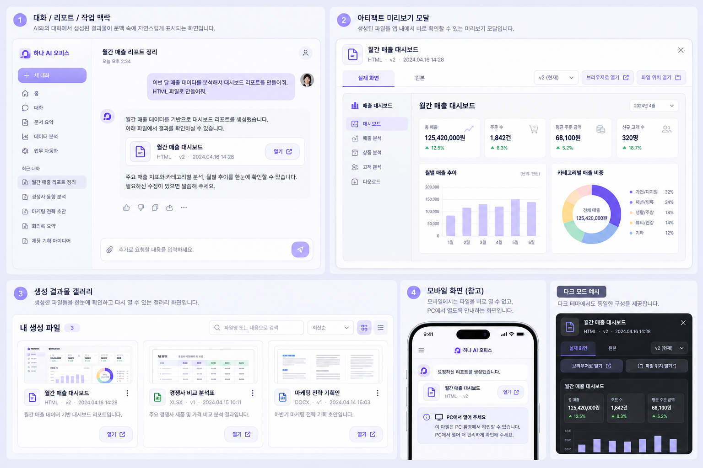

# 아티팩트 화면 시안

2026-10-31 · 대표 검토 전 제안. 그림은 배치와 분위기를 보여 주는 생성 시안이며 실제 앱 화면이 아니다. 그림 속 브랜드, 날짜, 검색·정렬·삭제 메뉴 및 XLSX·DOCX 예시는 제안 범위가 아니다. 지원 종류는 HTML(.html, .htm)과 문서(.md)다. 휴대폰의 열기 버튼은 실제 열기를 뜻하지 않으며 아래 안내 상태를 따른다.

## 화면과 동작

- **보고·대화·업무 카드**: 기존 첨부 파일처럼 얇은 테두리와 둥근 모서리를 사용한다. 종류별 문서 아이콘, 제목, `HTML` 또는 `문서`, `v2` 같은 버전과 `열기`를 표시한다. 제목이 길면 말줄임하고 전체 제목을 확인할 수 있게 한다. 카드는 컨테이너 너비 안에서 줄어든다. 열기는 크게 보기 창을 연다.
- **크게 보기**: 제목과 닫기, `실제 화면`·`원본` 탭, 버전 선택, `브라우저로 열기`·`파일 위치 열기`를 둔다. 기본은 실제 화면과 최신 버전이다. 버전을 바꾸면 선택한 버전의 내용이 표시되고, 원본은 실행하지 않는 텍스트로 보여 준다. 외부 링크는 확인 후 기본 브라우저로 연다. 창 안 내용은 독립적으로 스크롤하며 좁은 PC 창에서는 도구를 줄바꿈한다. 닫기 후 초점은 열었던 요소로 돌아간다.
- **갤러리**: 기존 결과물 카드의 제목·직원·랩·날짜와 요약을 유지하고, 첨부 이미지처럼 카드 안에 아티팩트 카드를 배치한다. 아티팩트의 열기는 결과물 상세와 구분해 크게 보기로 연결한다. 기존 이미지·링크·파일 정보와 함께 있을 수 있다.
- **휴대폰**: 제목·종류·버전은 표시하고 `PC에서 열어 주세요` 안내를 둔다. PC에서 확인할 수 있다는 설명을 함께 표시하며 미리보기나 외부 열기 동작은 제공하지 않는다. 기존 pc_only 표현을 재사용한다.

## 개발 전달 기준

- 기존 GalleryPage의 카드(`rounded-xl`, 테두리, 16px 안쪽 여백, 카드 간 12px)와 AttachmentView의 첨부 표시(`rounded-md`, 테두리, 작은 글씨)를 기준으로 한다. 카드 내부 간격은 8px, 종류 아이콘은 16px, 버튼 높이는 기존 작은 버튼을 따른다. 본문은 기존 앱 글꼴과 크기를 따른다.
- 색상은 하드코딩하지 않고 기존 `background`, `card`, `foreground`, `muted`, `muted-foreground`, `border`, `primary` 토큰을 사용한다. 실제 테마는 라벤더·스카이·노을·숲속·벚꽃·모노 6종이며 각각 라이트·다크를 따른다. 아티팩트 자체 화면 색상은 제작된 파일의 내용이다.
- 포커스 표시와 키보드 조작을 기존 버튼·다이얼로그와 일치시킨다. 탭 선택, 버전 변경, 닫기, 제목이 긴 경우와 좁은 창, 여러 결과물 및 이미지와의 공존을 확인한다. 그림의 샘플 대시보드는 실제 결과물 예시일 뿐 앱이 제공하는 기능이 아니다.
- 미리보기 격리, 네트워크·이동 제한 및 외부 링크 확인은 기획서의 필수 안전장치다. 시안은 보안 동작을 검증하지 않는다. 실패·불러오는 중·버전이 없는 경우의 구체 문구는 구현 단계에서 정한다.
- 4개 언어 번역과 실제 6개 테마·두 모드의 화면 검수는 구현 시 필요하다. 시안은 라벤더 라이트와 다크 분위기만 예시로 보여 주며 나머지 테마를 실측 검증하지 않았다.

## 생성 정보

내장 imagegen 사용. 요청 요지: 기존 앱의 절제된 라벤더 스타일로 보고/대화 카드, 실제 화면·원본 탭이 있는 크게 보기, 갤러리 카드, 휴대폰 PC 안내 및 다크 예시를 한 장의 제품 UI 시안으로 표현.
