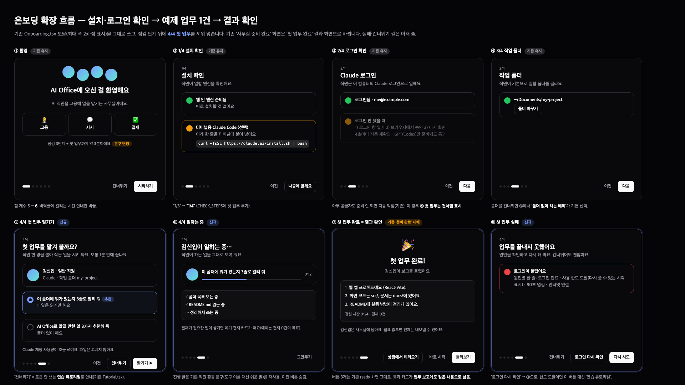
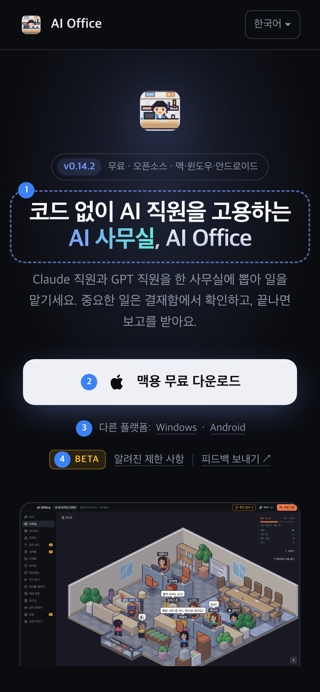
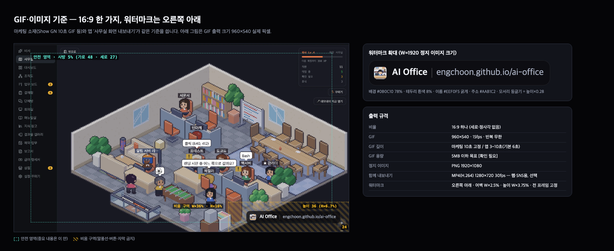

# 베타 1단계 디자인 시안 — 온보딩 흐름 · 소개 첫 화면 · GIF 기준

작성: 이디자(디자인 팀) · 기준 버전 0.14.2 · 상태: 시안(대표 검토 전)
연계: [beta-launch.md](beta-launch.md)(김기획 기획서) 필수 1·4번과 추가 6번의 화면 기준입니다. 2단계 구현 담당은 이 문서와 그림을 기준으로 만듭니다.
그림 원본: `beta-design/*.html` → `sh docs/specs/beta-design/render.sh`로 PNG를 다시 만듭니다(크롬 헤드리스).
표기: **[확인 필요]** = 근거가 없거나 대표 결정이 필요한 값.

---

## 1. 온보딩 흐름 — 설치·로그인 확인 → 예제 업무 1건 → 결과 확인

### 1-1. 바뀌는 점 요약
기존 `app/src/renderer/features/Onboarding.tsx`의 모달·점 표시·`CheckRow`·`CheckHeader`·`CheckFooter`를 그대로 씁니다. 새 부품은 만들지 않습니다.

| 단계 | 상태 | 바뀌는 내용 |
|---|---|---|
| ① 환영 | 유지 | 바닥 안내만 "점검 3단계 + 첫 업무까지 약 3분이에요"로 변경. 점 5개 → 6개 |
| ② 1/4 설치 확인 | 유지 | 단계 표시 `1/3` → `1/4` (`CHECK_STEPS`에 `firstTask` 추가) |
| ③ 2/4 로그인 확인 | 유지 | 그대로. 아무 공급자도 준비되지 않았으면 ⑤를 '건너뜀'으로 처리 |
| ④ 3/4 작업 폴더 | 유지 | 그대로. 폴더를 건너뛰면 ⑤에서 '폴더 없이 하는 예제'가 기본 선택 |
| ⑤ 4/4 첫 업무 맡기기 | **신규** | 직원 1명 + 예제 업무 2개 중 1개 선택 → '맡기기' |
| ⑥ 4/4 일하는 중 | **신규** | 진행 막대·경과 시간·진행 글 3줄. '그만두기'만 둠(이전 숨김) |
| ⑦ 첫 업무 완료 | **기존 ready 대체** | 결과 3줄 + 걸린 시간·결재 수. 버튼 3개(상점·바로 시작·둘러보기)는 기존 그대로 |
| ⑧ 첫 업무 실패 | **신규** | 원인 한 줄 + '다시 시도'·'로그인 다시 확인'·'건너뛰기' |

`STEPS = ['welcome','install','login','folder','firstTask','ready']`. ⑥·⑧은 `firstTask` 안의 상태(고르기 / 실행 중 / 실패)로 보고 점 위치는 같습니다.

### 1-2. 예제 업무 정의
| | A. 폴더 훑어보기 (추천) | B. 맡길 일 추천 |
|---|---|---|
| 지시문 | 이 폴더에 뭐가 있는지 3줄로 알려 줘 | AI Office로 내가 맡길 만한 일 3가지 추천해 줘 |
| 기본 선택 | 작업 폴더가 있을 때 | 작업 폴더를 건너뛰었을 때 |
| 쓰는 도구 | 읽기만(목록·파일 읽기) | 없음 |
| 결재 | 0건이 목표 — 읽기 도구는 결재 없이 허용 | 0건 |
| 시간 목표 | 60초 이내, 90초 넘으면 실패 처리 [확인 필요] | 같음 |

- **직원:** 첫 직원 "김신입 · 일반 직원"을 고용해 맡깁니다. 공급자는 준비된 쪽(Claude 우선, Claude가 없고 GPT만 준비됐으면 GPT). 업무가 끝나도 **사무실에 남깁니다**(⑦에 "필요 없으면 언제든 내보낼 수 있어요" 안내). [확인 필요: 남기기 vs 연습용으로 지우기 — 시안은 남기기]
- **비용 안내:** ⑤에 "Claude 계정 사용량이 조금 쓰여요. 파일은 고치지 않아요."를 꼭 보이게 둡니다(GPT일 때는 'ChatGPT 계정').
- **건너뛰기:** 토큰을 쓰지 않는 기존 연습 튜토리얼(`Tutorial.tsx`, [tutorial-scenario.md](tutorial-scenario.md))로 안내합니다.
- **결과 기록:** ⑦의 결과는 업무 보고에도 같은 내용으로 남습니다(새 저장 방식 없이 기존 업무 실행 기록 그대로).
- **결재가 생기면:** 예제는 결재 0건이 목표지만 예외로 뜨면 ⑥ 안에 기존 결재 카드를 그대로 띄웁니다(결재함으로 보내지 않음).

### 1-3. 실패 원인별 문구(⑧)
| 원인 | 한 줄 | 주 버튼 |
|---|---|---|
| 로그인 만료 | 로그인이 풀렸어요 | 로그인 다시 확인 → ③ |
| 사용 한도 도달 | 사용 한도에 닿았어요. {시각}부터 다시 쓸 수 있어요 | 연습 튜토리얼 |
| 시간 초과(90초) | 생각보다 오래 걸려요. 사무실에서 이어서 볼 수 있어요 | 다시 시도 |
| 인터넷 연결 | 인터넷 연결을 확인해 주세요 | 다시 시도 |

### 1-4. 화면 부품·색 대응 (앱: Tailwind + shadcn 토큰)
| 시안 요소 | 앱 부품·토큰 | 비고 |
|---|---|---|
| 모달 틀 | 기존 `bg-background rounded-2xl border p-8 max-w-2xl` | 그대로 |
| 점검 줄 | `CheckRow` (`isOk`/`isLoading`) | ⑧은 `border-destructive/60` + 빨간 아이콘 (CheckRow에 `isError` 추가) |
| 예제 고르기 | `CheckRow` 2개를 고르는 칸으로(`border-primary`) | 새 부품 없이 `RadioGroup`(shadcn) 사용 가능 |
| 진행 막대 | `bg-muted` 위 `bg-primary` | 실제 진행률이 없으므로 **움직이는 무한 막대** |
| 진행 글 | `text-muted-foreground text-xs` | 기존 직원 활동 문구(도구 이름 대신 쉬운 말) 재사용 |
| 결과 카드 | `bg-card rounded-xl border p-4 text-sm` | 3줄 넘으면 6줄까지 보이고 '업무 보고에서 전체 보기' |
| 완료·대기·오류 색 | `text-status-working` / `text-status-waiting` / `text-destructive` | 원색 값 직접 쓰기 금지 |
| 글자 | 제목 `text-xl font-bold`(⑦은 `text-2xl`), 설명 `text-sm text-muted-foreground` | 기존과 같음 |

### 1-5. 새 문구 키 (ko 원문, 4개 언어 함께 추가)
`onboarding.firstTask.title` 첫 업무를 맡겨 볼까요? · `.desc` 직원 한 명을 뽑아 작은 일을 시켜 봐요. 보통 1분 안에 끝나요. · `.staffName` 김신입 · `.staffRole` 일반 직원 · `.taskFolder` 이 폴더에 뭐가 있는지 3줄로 알려 줘 · `.taskFolderNote` 파일은 읽기만 해요 · `.taskIdeas` AI Office로 맡길 만한 일 3가지 추천해 줘 · `.taskIdeasNote` 폴더 없이 해요 · `.recommended` 추천 · `.costNote` {provider} 계정 사용량이 조금 쓰여요. 파일은 고치지 않아요. · `.run` 맡기기 · `.skip` 건너뛰기 · `.working` {name}이(가) 일하는 중… · `.workingDesc` 직원이 하는 일을 그대로 보여 줘요. · `.stop` 그만두기 · `.done` 첫 업무 완료! · `.doneDesc` {name}이(가) 보고를 올렸어요. · `.meta` 걸린 시간 {time} · 결재 {n}건 · `.keepNote` {name}은(는) 사무실에 남아요. 필요 없으면 언제든 내보낼 수 있어요. · `.failTitle` 업무를 끝내지 못했어요 · `.failDesc` 원인을 확인하고 다시 해 봐요. 건너뛰어도 괜찮아요. · `.retry` 다시 시도 · `.recheckLogin` 로그인 다시 확인 · `.fail.login|limit|timeout|network` (1-3 표) · `onboarding.welcome.footer` 문구 변경.
예제 지시문(`taskFolder`·`taskIdeas`)은 직원에게 보내는 글이므로 **앱 언어로** 보냅니다.

---

## 2. 소개 페이지 첫 화면 (`site/index.html` `.hero`)

| PC 1280 | 휴대폰 390 |
|---|---|
|  |  |

파란 번호 = 아래 설명 번호. 순서(위→아래): 앱 아이콘 → 버전 뱃지 → **① h1** → 소개 한 단락 → **② 큰 다운로드 버튼 1개** → **③ 다른 플랫폼 + ④ 베타·제한 사항·피드백 한 줄** → 앱 화면. 1280·390 모두 스크롤 없이 ④까지 보입니다.

### ① h1 제목 자리 (검색어 자리)
- 지금 제목("코드를 몰라도, AI 직원을 함께 고용하세요")에는 검색어가 없습니다. **h1 안에 주 검색어 1개 + 제품 이름**을 넣는 자리로 바꿉니다. 점선 상자가 그 자리입니다.
- 제안 문구(강조 `<em>` = 주 검색어) — **최종 문구는 2-2단계 검색엔진 작업에서 확정** [확인 필요]

| 언어 | h1 제안 | 주 검색어 |
|---|---|---|
| ko | 코드 없이 AI 직원을 고용하는 **AI 사무실**, AI Office | AI 사무실 · AI 직원 |
| en | Hire Claude & GPT staff in your **AI agent office** — no code | AI agent office |
| ja | コード不要でAI社員を雇える **AIオフィス**、AI Office | AI エージェント オフィス |
| zh | 无需代码，雇用 AI 员工的 **AI 办公室** — AI Office | AI 智能体 办公室 |

- 길이 기준: 2줄 이내(PC 60px · 휴대폰 29px). 줄바꿈 ` ` 한 곳. 일본어는 기존처럼 `.nw`로 끊김 방지.
- 기존 버전 뱃지 문구는 "무료 · 오픈소스 · 맥·윈도우·안드로이드"로 바꿔 **지원 플랫폼 표기**를 겸합니다.

### ② 기기 맞춤 큰 다운로드 버튼 1개
- 지금 `.cta`의 `dlButton()` 기기 판별을 그대로 쓰되, **버튼 1개만** 크게(높이 60 / 휴대폰 56·가로 꽉 참, 둥글기 14, 글자 18 굵게, 아래 파란 빛 그림자).
- 문구: "{OS}용 무료 다운로드" + 작은 글씨 확장자(`.dmg · Apple Silicon` / `.zip` / `.apk`). 휴대폰에서는 작은 글씨 숨김.

| 방문 기기 | 큰 버튼 | ③ 작은 링크 |
|---|---|---|
| 맥 | 맥용 | Windows · Android |
| 윈도우 | 윈도우용 | Mac · Android |
| 안드로이드 휴대폰 | 안드로이드용 + 버튼 아래 "PC 앱과 함께 써요" 한 줄 | Mac · Windows |
| 아이폰·기타 | 맥용 + 버튼 아래 "컴퓨터에서 설치해 주세요" 한 줄 | Windows · Android |

- 윈도우 버튼 아래 설명은 QA 확인 전까지 단정 문구를 쓰지 않습니다(기획서 4번 기준).

### ③·④ 한 줄 메타 줄
- PC: `다른 플랫폼: Windows · Android │ [BETA] 알려진 제한 사항 │ 피드백 보내기 ↗` 를 **한 줄**에. 휴대폰: ③ 한 줄 + ④ 한 줄로 두 줄(구분선 1개 숨김).
- **BETA 뱃지:** 노란색 작은 뱃지(글자 11.5 굵게·자간 넓게). 링크 아님.
- **알려진 제한 사항:** 같은 페이지 `#limits` 칸(FAQ 위에 새로 둠, 4개 언어)으로 이동. 내용은 기획서 §4에서 **사실 확인된 항목만**. 검색에도 잡히도록 별도 페이지가 아닌 본문으로 둡니다.
- **피드백 보내기:** GitHub 새 이슈 화면(`/issues/new?labels=beta-feedback`)을 새 탭으로. 앱 안 피드백 버튼과 같은 곳으로 모읍니다(소개 페이지에서는 버전·OS 자동 기입 없음).

### 화면 부품·색 대응 (소개 페이지 CSS 변수)
| 시안 요소 | 소개 페이지 변수·클래스 | 비고 |
|---|---|---|
| 큰 버튼 | `.btn.primary` 확장 → `.btn.hero` (`--fg` 배경, `#0b0c10` 글자) | 그림자 `rgba(124,156,255,.45)` = `--accent` 계열 |
| 작은 링크 | 기존 `.also a` (`--muted`, 밑줄 `--line2`) | `.also` → `.meta`로 이름 변경 권장 |
| 구분선 | `--line2` 1×14 | |
| BETA 뱃지 | **신규 변수 `--beta: #fbbf24`** (배경 12%, 테두리 35%) | 페이지에 노랑 계열이 없어 신규. `--accent` 파랑으로 대체하면 버전 뱃지와 구분이 안 됨 |
| h1 | 기존 `h1` + `.hero h1 em` 그라데이션 | 크기만 PC `clamp(34px,5.6vw,60px)`, 휴대폰 29px |
- 원색 값 직접 쓰기 금지 — 새 색은 `--beta` 하나만 추가합니다.

### 문구 키 (site `I18N` 4개 언어)
`hero.title`(①로 교체) · `badge.oss`(플랫폼 표기로 교체) · `btn.download` → "{os}용 무료 다운로드" · 신규 `hero.beta`(BETA), `hero.limits`(알려진 제한 사항), `hero.feedback`(피드백 보내기), `hero.android.note`(PC 앱과 함께 써요), `hero.mobile.note`(컴퓨터에서 설치해 주세요), `limits.title`, `limits.1~n`.

---

## 3. GIF·이미지 기준 (마케팅 소재 + 앱 '사무실 화면 내보내기' 공통)

### 3-1. 규격 (확정안)
| 항목 | 기준 |
|---|---|
| 비율 | **16:9 하나**. 세로·정사각은 만들지 않음(기획서 '범위 밖: SNS 크롭'과 같음) |
| GIF 크기 | 960×540 · 15fps · 반복 무한 |
| GIF 길이 | 마케팅 소재 **10초 고정** / 앱 내보내기 3~10초, 기본 6초 |
| GIF 용량 | 5MB 이하 목표 [확인 필요 — 긱뉴스·GitHub 업로드 한도 확인] |
| 정지 이미지 | PNG 1920×1080 |
| 함께 내보내기(선택) | MP4(H.264) 1280×720 30fps — 웹·SNS는 GIF보다 이 쪽이 가볍고 선명 |
| 첫 프레임 | 직원이 일하는 장면(빈 사무실 금지) — 미리보기로 첫 장만 보이는 곳 대비 |
| 반복 | 끝 1초는 정지 유지 후 처음으로(페이드 없음) |

### 3-2. 워터마크
> 갱신: 워터마크 색(불투명 100%로 변경)·앱 GIF 기본 길이(10초)·버튼/완료 안내는 `gif-export-design.md`가 우선합니다.

- 내용: **앱 아이콘 + "AI Office" + 구분선 + "engchoon.github.io/ai-office"** (https 없이). 주소는 상수 1곳에서 읽어 도메인이 바뀌면 함께 바뀌게.
- 위치: **오른쪽 아래 고정**, 모든 프레임 동일, 움직이지 않음.
- 크기는 출력 폭 W 기준 비율로 정합니다(어떤 크기로 내보내도 같은 모양).

| 항목 | 비율 | W=960 (GIF) | W=1920 (PNG) |
|---|---|---|---|
| 바깥 여백(오른쪽·아래) | W×2.5% | 24 | 48 |
| 상자 높이 | W×3.75% | 36 | 72 |
| 아이콘 | 높이×0.61 | 22 | 44 |
| 글자 크기 | 높이×0.36 | 13 | 26 |
| 둥글기 | 높이×0.28 | 10 | 20 |
| 안쪽 여백(좌/우) | 높이×0.2 / 0.33 | 7 / 12 | 14 / 24 |

- 색: 상자 `#0B0C10` 78% + 테두리 흰색 8%, "AI Office" `#EEF0F5` 굵게, 주소 `#AAB1C2` 보통 — 소개 페이지 `--bg`·`--fg` 계열. 밝은 장면에서도 읽히도록 반투명 상자를 항상 깝니다.
- **비움 구역:** 오른쪽 아래 W×36% · H×16%에는 말풍선·버튼·자막을 두지 않습니다(마케팅 편집 시 확인, 앱은 상관없음 — 덮어 그림).
- **안전 영역:** 사방 5% 안쪽에 중요한 내용(직원·말풍선)을 둡니다.

### 3-3. 앱 내보내기 적용
- 내보내는 범위는 **사무실 맵 화면만**(사이드바·상단 막대 제외). 맵 화면 비율이 16:9가 아니면 가운데를 기준으로 16:9로 잘라 내고, 모자라는 쪽은 `--bg`(#0B0C10)로 채웁니다.
- 워터마크는 내보내는 순간 위 표 수치로 그려 넣습니다. **끄는 설정은 두지 않습니다** [확인 필요 — 베타 기간 끄기 허용 여부].
- 개인 정보: 직원 이름·폴더 경로·말풍선 글이 그대로 찍히므로, 내보내기 전 미리보기를 한 번 보여 줍니다.
- 마케팅 소재는 `beta-design/gif-spec.html`의 워터마크 상자(`.wm`)를 그대로 써서 만들면 앱 내보내기와 같은 모양이 됩니다.

---

## 4. 디자인-구현 갭
- 소개 페이지 노란 계열 색이 없음 → `--beta` 1개 신규.
- `CheckRow`에 오류 상태 없음 → `isError` 추가(⑧).
- 온보딩에서 직원 고용·업무 실행·결과 받기를 모달 안에서 하는 흐름은 처음 → 기존 고용·지시 기능을 불러 쓰는 연결만 필요(새 화면 부품 없음).
- 소개 페이지 `#limits` 칸 신규(FAQ 위).
- GIF 인코딩(앱 내부)은 새로 필요 — 구현 방법은 GIF 카드 진행 때 정함.

## 5. 확인 필요 모음
1. 첫 직원 '김신입'을 온보딩 뒤에 남길지(시안: 남김).
2. 예제 업무 시간 기준 60초 목표 / 90초 실패.
3. h1 4개 언어 최종 문구(2-2단계 검색엔진 작업에서 확정).
4. GIF 5MB 한도.
5. 앱 내보내기 워터마크 끄기 허용 여부(시안: 허용 안 함).
