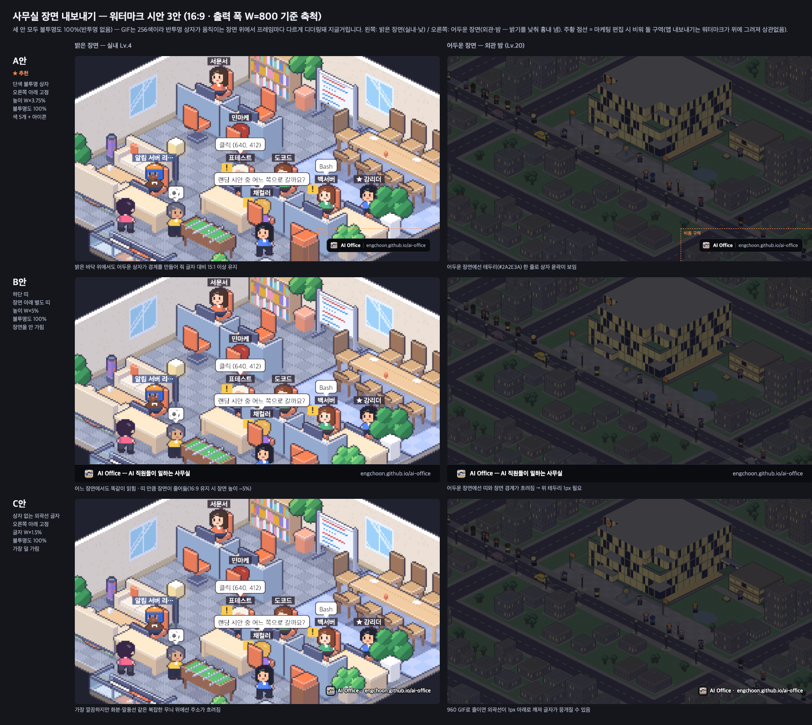
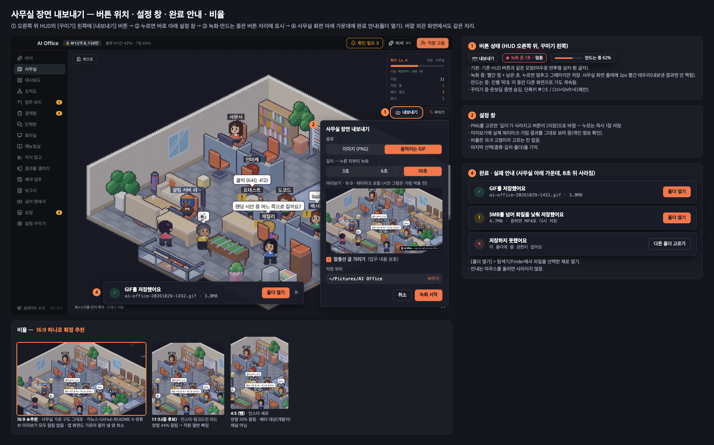

# 사무실 장면 내보내기(GIF·이미지) — 디자인 시안

> 기획: `docs/specs/beta-launch.md` 6번 · 상위 업무 'GIF·이미지 내보내기 (베타 추가 범위)' 1/3단계
> 앞선 기준: `docs/specs/beta-onboarding-hero-gif.md` 3장. **이 문서가 그 3-2 워터마크 색(반투명 78%)과 3-1 앱 GIF 기본 길이(6초)를 바꿉니다** — 아래 1·2장 참고.
> 코드는 고치지 않았습니다. 시안 그림은 `sh docs/specs/gif-export-design/render.sh`로 다시 만들 수 있습니다.

---

## 1. 비율 — **16:9 하나로 확정 추천**

| 후보 | 판단 | 이유 |
|---|---|---|
| **16:9** | ★ 확정 추천 | 사무실 맵과 앱 창이 가로라 잘라 낼 양이 가장 적음. 긱뉴스 본문·GitHub README·X·유튜브 미리보기에서 잘리지 않음 |
| 1:1 | 나중 후보 | 인스타·링크드인 피드용. 같은 장면에서 양옆 약 44%가 잘려 직원 절반이 빠짐. 쓰려면 '가운데 직원 기준 자르기'가 따로 필요 |
| 4:5 | 뺌 | 인스타 세로용. 양옆 약 55%가 잘림. 베타 대상(개발자) 채널이 아님 |

- 크기: PNG 1920×1080, GIF 960×540·15fps (앞선 기준 3-1과 같음).
- 맵 화면이 16:9가 아니면 가운데 기준으로 자르고, 모자라는 쪽은 `#0B0C10`으로 채웁니다.
- 찍는 범위: **사무실 맵만** 찍습니다. 사이드바·상단 막대·HUD(현황판·꾸미기·확대 버튼·도움말 줄)는 빼고 찍습니다.

## 2. 워터마크 — 3안 (그림 1)

공통 사항
- 내용: 앱 아이콘 + "AI Office" + 주소 `engchoon.github.io/ai-office`. 주소는 상수 1곳에서 읽습니다.
- 모든 프레임의 같은 자리에 넣고 움직이지 않습니다. 결과물 100%에 들어갑니다.
- **불투명도 100%로 정하고, 반투명은 쓰지 않습니다.** GIF는 프레임마다 256색으로 줄이기 때문에, 움직이는 장면 위에 반투명 상자를 깔면 프레임마다 디더링이 달라져 상자가 지글거립니다. 그래서 단색 상자 + 2색 글자로 정합니다. 그 결과 앞선 기준의 "상자 78%·테두리 흰색 8%"는 아래 A안 값으로 바뀝니다.

| | **A안 ★추천 — 단색 상자** | B안 — 하단 띠 | C안 — 외곽선 글자 |
|---|---|---|---|
| 위치 | 오른쪽 아래 고정 | 결과물 맨 아래 전체 폭 | 오른쪽 아래 고정 |
| 크기(W=출력 폭) | 높이 W×3.75%, 여백 W×2.5% (960→36/24px, 1920→72/48px) | 띠 높이 W×5% (960→48px) | 글자 W×1.5% (960→14px), 여백 W×2.5% |
| 불투명도 | 100% | 100% | 100% |
| 색 | 상자 `#0B0C10`, 테두리 `#2A2E3A` 1px, "AI Office" `#FFFFFF` 굵게, 구분선 `#3A3F4D`, 주소 `#AAB1C2` | 띠 `#0B0C10` + 위 테두리 `#2A2E3A`, 글자는 A안과 같음, 왼쪽에 한 줄 소개 | 흰 글자 + `#0B0C10` 외곽선 1.5px |
| 밝은 장면 | 잘 읽힘(대비 15:1 이상) | 잘 읽힘 | 화분·말풍선 같은 복잡한 무늬 위에서 주소가 흐려짐 |
| 어두운 장면 | 테두리 덕분에 상자 윤곽이 보임 | 띠와 장면 경계가 흐려 위 테두리가 꼭 필요 | 읽히지만, 960 크기로 줄이면 외곽선이 깨짐 |
| 장면 가림 | 오른쪽 아래 약 36%×7% | 없음(대신 장면 높이 −5%) | 가장 적음 |
| GIF 색 수 | 5색 + 아이콘 | 5색 + 아이콘 | 2색 + 아이콘 |

- **추천은 A안입니다.** 어느 장면에서도 읽히고, 앞선 기준(크기 표·비움 구역)과 마케팅 소재를 그대로 이어 쓸 수 있습니다. 1:1을 나중에 추가할 때도 같은 규칙(W 비율)으로 그대로 맞습니다.
- B안은 SNS에서 '광고 띠'처럼 보이기 쉽고, 장면이 줄어듭니다. 마케팅 소재 끝 1초용 엔딩 카드로만 쓰기를 권합니다.
- 아이콘: GIF에서는 아이콘 색이 8색 이하가 되도록 미리 줄여 둔 판을 씁니다. [확인 필요] 지금 `icon.png`가 줄였을 때 뭉개지는지 구현 때 확인합니다.
- 비움 구역(오른쪽 아래 W×36%·H×16%)은 마케팅 편집에만 적용합니다. 앱 내보내기는 워터마크를 맨 위에 덮어 그립니다.

## 3. 진입점·흐름 (그림 2)

### ① 내보내기 버튼
- 자리: 사무실 맵 오른쪽 위 HUD에서 **[꾸미기] 바로 왼쪽**에 둡니다. 같은 줄에 놓아 HUD 세로 길이는 늘어나지 않습니다. 실내와 외관 화면 모두 같은 자리입니다.
- 모양: 기존 HUD 버튼과 같습니다(`rounded-lg border-white/10 bg-[#1a1d28]/90 text-xs`). 아이콘은 lucide `Camera`, 글자는 "내보내기"입니다.
- 상태
  - 기본: "📷 내보내기"
  - 녹화 중: 빨간 점 + "녹화 중 N초 · 멈춤". 누르면 그때까지만 저장합니다. 맵 둘레에 2px 빨간 테두리가 생기며, 결과물에는 찍히지 않습니다.
  - 만드는 중: 진행 막대 + "만드는 중 62%". 다른 화면으로 가도 계속 만듭니다.
- 숨기는 경우: 꾸미기 중, 온보딩 중, 휴대폰 화면(범위 밖)
- 단축키: ⌘⇧E / Ctrl+Shift+E (제안 — [확인 필요] 기존 단축키와 겹치는지)

### ② 설정 창 (버튼 바로 아래 팝오버, 폭 320)
- 종류: [이미지(PNG) | 움직이는 GIF]
- 길이: [3초 | 6초 | **10초**]. 기본은 기획서대로 10초입니다. PNG를 고르면 이 칸이 사라집니다. 길이를 10초로 고정하기로 하면 이 줄을 통째로 뺍니다(열린 질문).
- GIF는 누른 **뒤부터** 녹화합니다. 이미 지나간 장면을 저장하지 않으므로, 메모리에 계속 담아 둘 필요가 없습니다.
- 미리보기: 16:9 자르기, 워터마크, 가림을 적용한 실제 결과 모양을 보여 줍니다. 비율은 고정이라 고르는 칸을 두지 않습니다.
- **말풍선 글 가리기: 기본 켬.** 말풍선에 업무 내용이 그대로 나오기 때문입니다. 말풍선 모양은 남기고 글만 `···`로 바꿉니다. 직원 이름표는 남깁니다. [확인 필요] 이름표도 가릴지
- 저장 위치: 기본은 `~/Pictures/AI Office`(윈도우는 `사진\AI Office`)이고 [바꾸기]로 폴더를 고릅니다. 마지막에 고른 종류·길이·폴더를 기억합니다.
- 버튼: [취소] [녹화 시작] (PNG를 고르면 [저장])
- 파일 이름: `ai-office-YYYYMMDD-HHmm.gif|png`

### ④ 완료·실패 안내 (사무실 맵 아래 가운데, 폭 500)
| 경우 | 문구 | 버튼 |
|---|---|---|
| 성공 | **GIF를 저장했어요** · 파일 이름 · 용량 | [폴더 열기] [×] |
| 용량 초과 후 다시 줄임 | **5MB를 넘어 화질을 낮춰 저장했어요** · 용량 | [폴더 열기] |
| 실패 | **저장하지 못했어요** · 원인(예: 이 폴더에 쓸 권한이 없어요) | [다른 폴더 고르기] |

- [폴더 열기]를 누르면 Finder/탐색기가 파일을 선택한 채로 열립니다(Electron `shell.showItemInFolder`).
- 안내는 8초 뒤 사라지고, 마우스를 올리고 있으면 사라지지 않습니다. 같은 안내를 앱 알림 목록에는 남기지 않습니다.

## 4. 화면 부품·색 대응 (앱: Tailwind + shadcn 토큰)
| 시안 요소 | 코드 | 비고 |
|---|---|---|
| 내보내기 버튼 | HUD 버튼 클래스 그대로(`OfficeMap.tsx` 꾸미기 버튼과 동일) | 새 부품 없음 |
| 설정 창 | 기존 Popover(shadcn) + 세그먼트 버튼 | 세그먼트가 없으면 버튼 묶음으로 만듦 |
| 선택된 세그먼트·주 버튼 | `bg-primary text-primary-foreground` | 시안의 주황 |
| 녹화 중 빨강 | `text-destructive` / `border-destructive` | |
| 성공 아이콘 | `text-status-working` 계열 초록 | [확인 필요] 토큰 이름 |
| 경고 아이콘 | `text-status-waiting` | |
| 완료 안내 상자 | HUD 상자 스타일(`bg-[#1a1d28]/90 border-white/10`) | 앱에 토스트 부품이 없음 → 맵 위 작은 상자로 새로 만듦 |
| 워터마크 색 | 내보내기 그림에만 쓰는 고정값(`#0B0C10` 등) | 화면 테마와 무관하게 늘 같아야 하므로 토큰을 쓰지 않음 |

## 5. 디자인-구현 갭
- 장면 캡처·GIF 인코딩·용량 맞추기를 새로 만들어야 합니다. 방법은 기술 조사 카드에서 정합니다.
- 말풍선 글을 가리고 HUD를 뺀 채 '내보내기용으로 한 번 더 그리는' 경로가 필요합니다(화면을 그대로 찍는 방식이면 HUD가 찍힘).
- 맵 위 완료 안내 상자(토스트)는 새 부품입니다.
- 새 문구 키(ko 원문, 4개 언어 함께 추가): `export.button`, `export.title`, `export.kind.png`, `export.kind.gif`, `export.length`, `export.preview`, `export.hideBubbles`, `export.folder`, `export.change`, `export.start`, `export.save`, `export.recording`, `export.stop`, `export.encoding`, `export.done`, `export.doneShrunk`, `export.failed`, `export.openFolder`, `export.pickOther`

## 6. 확인 필요 (대표님 결정)
1. 비율 16:9 하나로 확정할지 (추천: 예. 1:1은 나중에)
2. 워터마크 A안(단색 상자) 채택 여부, 그리고 앞선 기준의 반투명 78%를 불투명 100%로 바꾸는 것
3. 워터마크 끄기 허용 여부 (제안: 베타 동안 항상 넣음)
4. GIF 길이: 3·6·10초 중 고르기 vs 10초 고정
5. 말풍선 글 가리기 기본 켬 / 이름표는 남김
6. 용량 5MB 한도, 넘으면 자동으로 화질을 낮출지 (MP4 추가 여부는 기술 조사 결과를 보고 결정)
